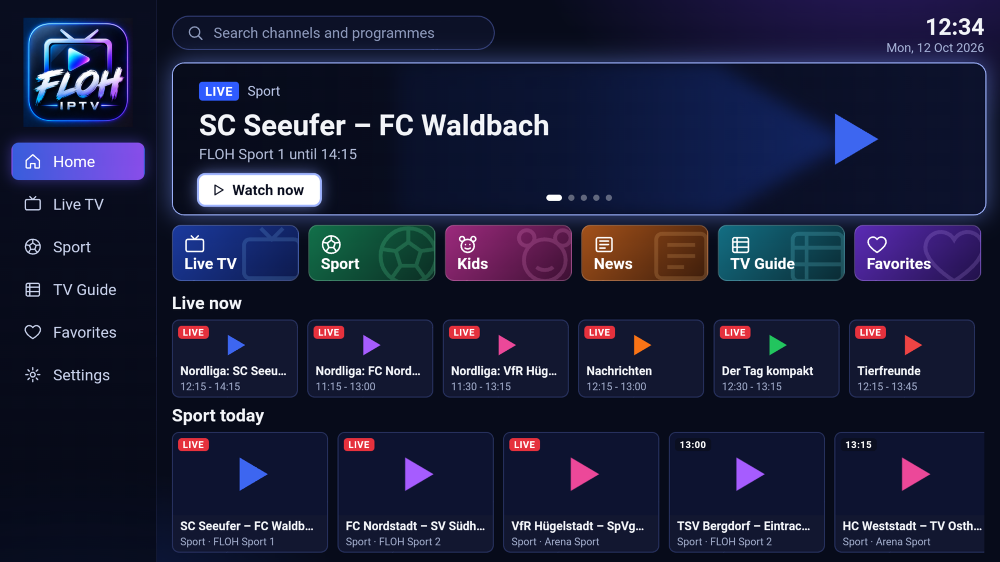
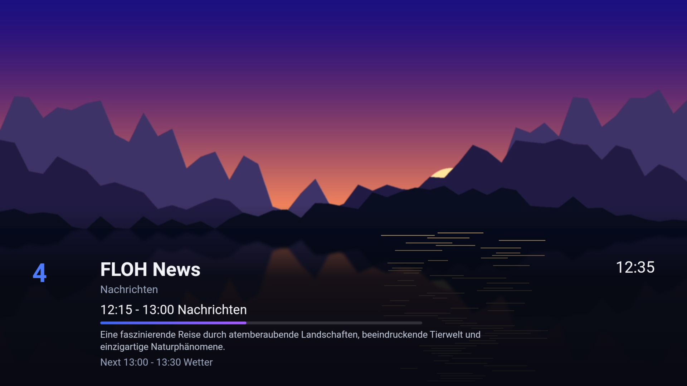

# Installing FLOH IPTV on Fire TV and Android TV

*English · [Deutsch](ANLEITUNG-FIRETV.md)*

FLOH IPTV is a player for IPTV playlists (M3U) with a TV guide. It brings no channels: you
enter the playlist link of your own provider.

## Fire TV (Stick, Cube)

1. Install **Downloader**: on the home screen choose **Find** / **Search**, type "Downloader" and
   install the app by *AFTVnews*.
2. Allow it to install apps: **Settings → My Fire TV → Developer Options → Apps from Unknown
   Sources** (or **Install unknown apps**) and switch on **Downloader**.
   No developer options? Open **Settings → My Fire TV → About** and click the device name seven
   times.
3. Open Downloader and enter this link:
   `kingflooow.github.io/floh-iptv/apk`
   (or in full: `https://github.com/kingflooow/floh-iptv/releases/latest/download/FLOH-IPTV.apk`)
4. **Install**, then **Open**. FLOH IPTV is now under *Apps*.

## Android TV / Google TV

The same with the **Downloader** app from the Play Store. Allow Downloader to install unknown
apps when the device asks the first time.

## Entering your playlist

1. Open FLOH IPTV and press **OK**, then **OK** again on *Playlist link*.
2. Type your provider's playlist link on the on-screen keyboard and confirm with
   **⏯ (Next)**.
3. Press **Back**: the channel list loads. The app takes the TV guide (EPG) from the playlist;
   otherwise you can enter a guide link in the settings.

## Fire TV remote

| Key | Does |
|---|---|
| OK (centre) | open the channel list, play a channel |
| Up / Down | next / previous channel |
| ⏩ / ⏪ | next / previous channel, a page in the list |
| ⏯ | info bar |
| ☰ (menu) | settings |
| Back | hide the info bar, then Home; twice on Home: exit |

Remotes with colour and channel keys (many Android TV devices) work as on a Samsung TV:
YELLOW favorite, GREEN favorites, BLUE settings, CH+/CH- channels.

## Updates

Install the new APK the same way with Downloader. It replaces the old version; settings and
favorites stay.
