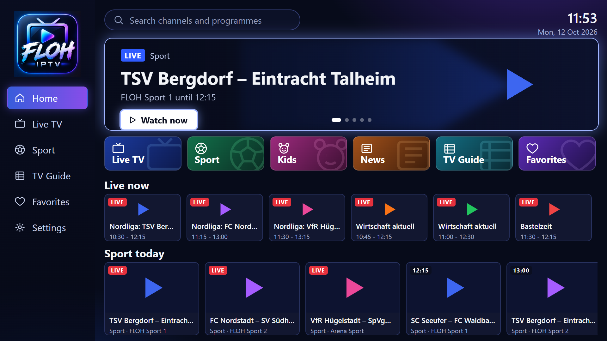
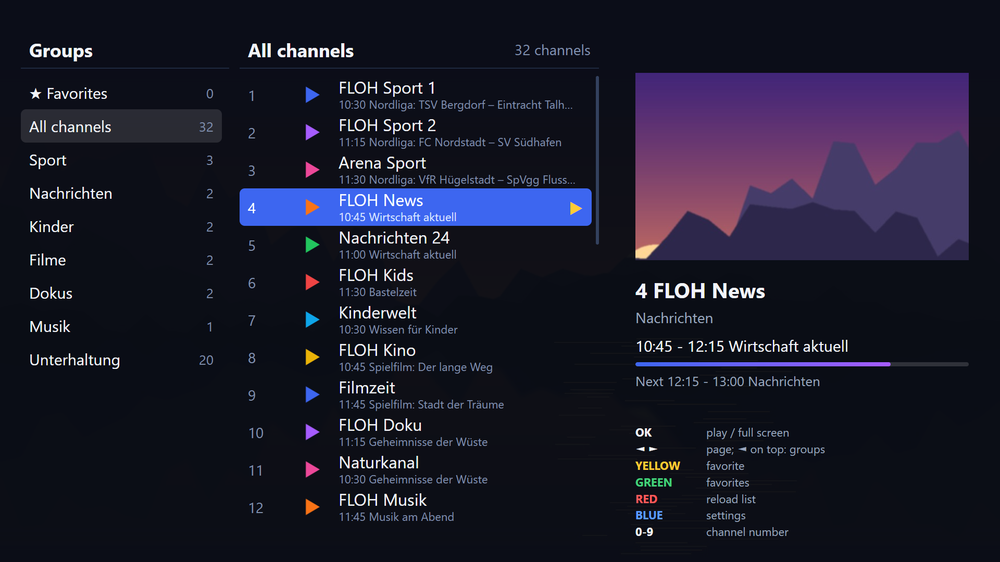
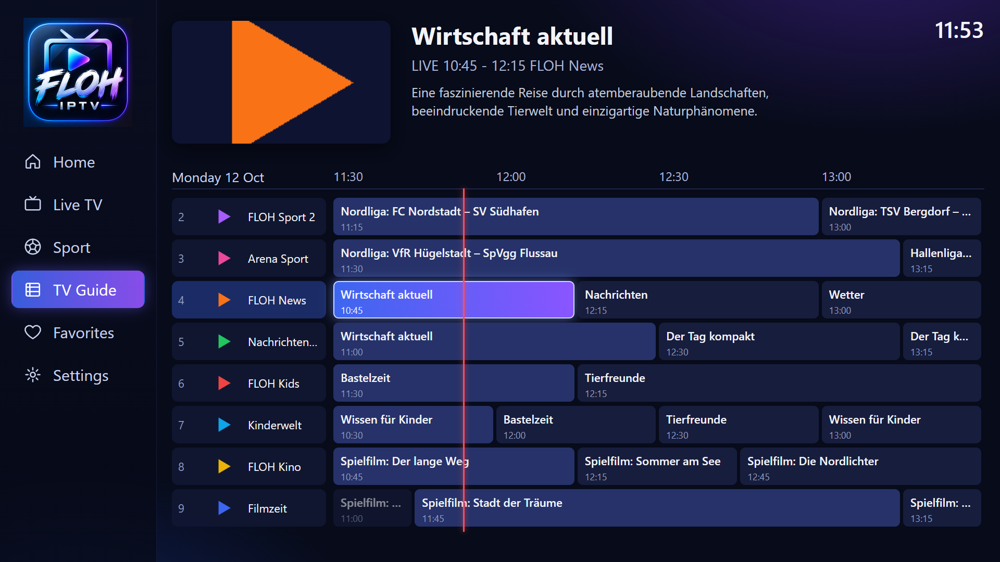
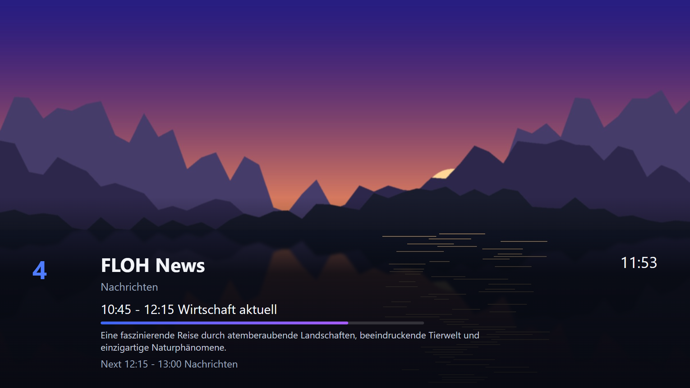
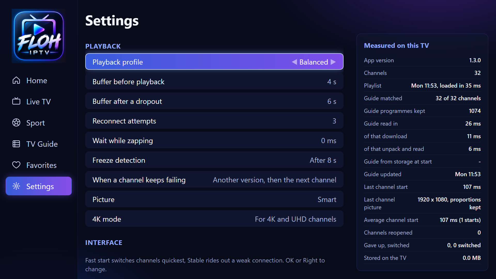

# FLOH IPTV

Ein schneller IPTV-Player für **Samsung-Fernseher**, **Fire TV** und **Android TV**.
Die App bringt keine Sender mit: Du trägst den M3U-Link deines eigenen Anbieters ein.

## Herunterladen

| Gerät | Datei | Anleitung |
|---|---|---|
| Fire TV, Android TV, Google TV | [FLOH-IPTV.apk](https://github.com/kingflooow/floh-iptv/releases/latest/download/FLOH-IPTV.apk) | [Anleitung Fire TV / Android TV](ANLEITUNG-FIRETV.md) |
| Samsung-Fernseher ab 2017 | [FLOH-IPTV.wgt](https://github.com/kingflooow/floh-iptv/releases/latest/download/FLOH-IPTV.wgt) | [Anleitung Samsung](ANLEITUNG-SAMSUNG.md) |

Ältere Versionen und Änderungen stehen unter [Releases](https://github.com/kingflooow/floh-iptv/releases).

**Ausprobieren ohne eigene Liste:** Trag in der App diese Demo-Playlist ein:
`https://kingflooow.github.io/floh-iptv/demo.m3u`
Sie enthält acht erfundene Sender mit eigenen Demo-Bildern und Programm.

## Was die App kann

- **Schnell auch bei riesigen Listen**: Playlist und Programmführer sind in Sekunden da und
  werden auf dem Gerät gespeichert; die Senderliste blättert seitenweise.
- **Startseite** mit den Live-Spielen aus dem Programm deiner eigenen Sportsender, Kacheln für
  Live TV, Sport, Kinder, Nachrichten, Programm und Favoriten.
- **Senderliste** mit Gruppen, Vorschau, Favoriten, Senderwahl per Zahl und Suche nach
  Sendern und Sendungen.
- **TV-Programm** (EPG) als Raster über die nächsten Stunden.
- **Hängt ein Sender**, wählt die App ihn selbst neu an und weicht danach auf eine andere
  Fassung (z. B. SD statt HD) oder den nächsten Sender aus.
- **Bildformat „Smart“**: SD-Sender füllen das ganze Bild statt schmal zu bleiben.
- **Einstellungen** für Puffer, Senderwechsel, Bildformat und Programm, dazu die auf deinem
  Gerät gemessenen Ladezeiten.

| Senderliste | Programm |
|---|---|
|  |  |
| **Vollbild mit Infoleiste** | **Einstellungen** |
|  |  |

## Hinweis

FLOH IPTV ist ausschließlich ein Abspielprogramm. Es enthält keine Sender, Playlists oder
Zugänge und gehört zu keinem Anbieter. Für die Inhalte, die du über deine eigene Playlist
abspielst, bist du selbst verantwortlich. Die Bilder zeigen eine erfundene Senderliste.

[Datenschutz](DATENSCHUTZ.md) · Fragen und Fehler bitte unter [Issues](https://github.com/kingflooow/floh-iptv/issues).
